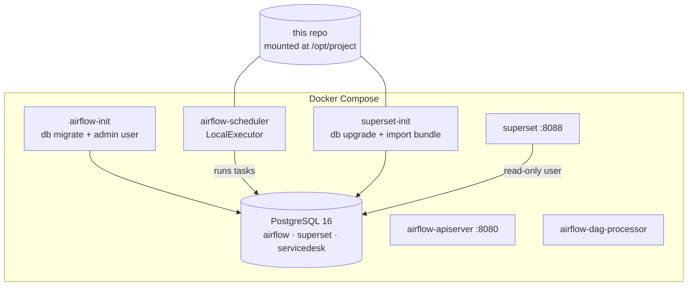

# Architecture

## The scenario

An IT service desk reports its performance in a Tableau dashboard. The team wants to move to a **self-hosted, open-source BI tool** (cost, data control, dashboards in version control) **without the numbers changing**. This project builds the new stack, keeps Tableau running from the same data during the transition, and proves on every run that both show identical KPIs.

## Components

| Component | Role | Why this choice |
|---|---|---|
| **Apache Airflow 3.3** | Orchestrates the pipeline, retries, keeps run history | Industry standard; each step is a visible, re-runnable task |
| **PostgreSQL 16** | Warehouse plus metadata for Airflow and Superset | One server for a laptop demo; strong SQL (window functions, `percentile_cont`, `FILTER`) |
| **Apache Superset 6.1** | New self-hosted BI | Apache-licensed, SQL-first, semantic layer (metrics defined once), dashboards export/import as YAML |
| **Tableau** | Legacy BI during the migration | Reads a CSV extract, since Tableau Public can't connect to databases |
| **`pipeline` package** | All Python logic | Testable and runnable without Airflow (`python -m pipeline.cli`); the DAG stays thin |

## Data flow

1. **Extract**: download the UCI zip (skipped if the CSV is already in `data/raw/`), then check the file against a contract: exact 36-column header, row count, incident ID and date formats. A changed export format fails here, before anything is loaded.
2. **Load**: `COPY` into `raw.incident_events`, every column as text. Loading never fails on a bad value; typing happens later, where it can be checked.
3. **Transform** (SQL files in `sql/`, one Airflow task each):
   - `staging`: types, `?` → NULL, day-first dates, booleans, split priority codes, flags invalid states, marks each incident's first and final snapshot.
   - `marts`: star schema with dimensions, a state-interval fact (time in each state) and `fact_incident` (one row per incident).
   - `reports`: dashboard-ready views and tables. `reports.incidents_analysis` is the single population every tool reads.
4. **Check**: data quality checks after staging and after the marts ([details](data-quality-and-validation.md)).
5. **Publish**: CSV extracts for Tableau in `exports/tableau/`. Superset reads PostgreSQL live.
6. **Validate**: KPI parity between the legacy Tableau logic and the new SQL, 152 comparisons.
7. **Record**: `audit.pipeline_runs`, `audit.dq_results` and `audit.kpi_validation` keep the history; the QA dashboard shows it.

## Design decisions

**Full refresh, idempotent.** The source is a complete snapshot, so every run rebuilds all tables. Running twice gives the same result, which makes reruns and backfills safe. With a growing source, the natural next step is incremental loading by `sys_updated_at`.

**Thin DAG, logic in a package.** Airflow handles scheduling, retries and visibility; the logic lives in `pipeline/`. This keeps the code unit-testable, lets CI run the pipeline without Airflow, and makes changing orchestrators cheap.

**One population, defined once.** `reports.incidents_analysis` (incidents opened 29 Feb – 31 May 2016) feeds the KPI views, Superset and the Tableau extract. Most "the dashboards disagree" problems are actually different filters; this removes that class of error.

**Metrics defined once per tool, checked against each other.** KPI SQL lives in `sql/reports/02_kpis.sql`. Superset's dataset metrics use the same expressions, and Tableau's calculated fields are mirrored in `pipeline/validation.py`. The validation step and `superset/verify_kpis.py` prove all three agree.

**Dashboards as code.** `superset/build_dashboards.py` creates datasets, metrics, charts, filters and layouts through Superset's API and exports Superset's native YAML bundle into `superset/assets/`. Docker imports that bundle at start-up, so a fresh machine gets identical dashboards, and changes are reviewable in git.

**Least privilege.** Superset connects as `superset_reader`, which can read every schema the pipeline creates (through default privileges) but cannot change anything.

**Errors stop, warnings inform.** Checks that would make KPIs wrong (lost rows, broken keys, negative durations) stop the pipeline. Known, documented source issues (5 invalid state rows, tracking changes) are recorded as warnings and shown on the QA dashboard instead of blocking every run.

**Light-weight Docker setup.** LocalExecutor without Redis or Celery and one Postgres server keep the stack at about 4 GB of memory. The service definitions follow the official Airflow 3.3 docker-compose reference and the official Superset image.

## What changes in production

- Credentials from a secrets manager instead of `.env`; HTTPS and SSO in front of Airflow and Superset.
- Separate database servers (or a managed warehouse) for Airflow metadata, Superset metadata and analytics data.
- Incremental loads, alerting on failed runs (email or Slack callback) and a staging environment for dashboard changes.
- CeleryExecutor or KubernetesExecutor if the DAG count grows.
