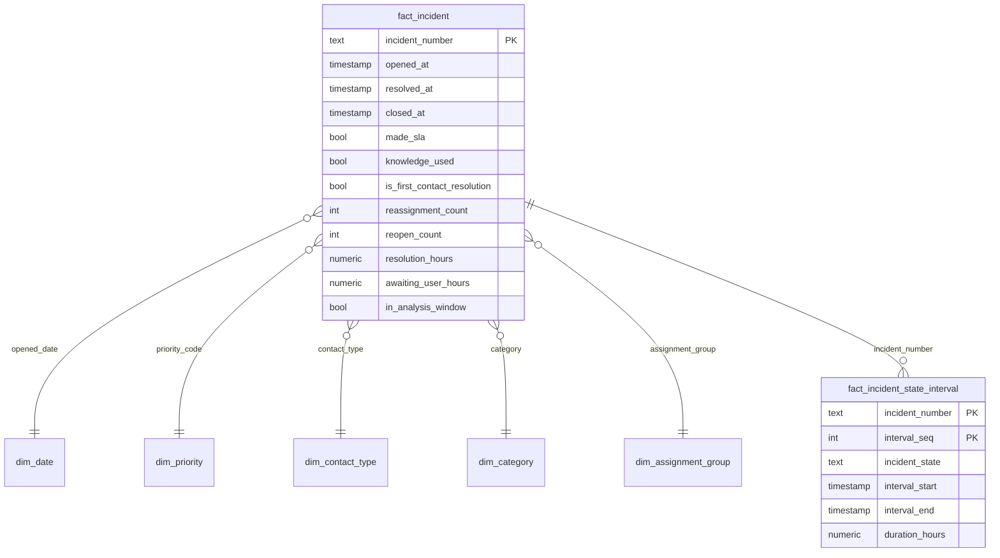

# Data model

## Source

`incident_event_log.csv`: an **event log**. Each row is one update of an incident in ServiceNow, so one incident appears many times (141,712 rows for 24,918 incidents). Values are anonymised by the publisher (`Caller 2403`, `Category 53`); `?` means unknown. Timestamps are day-first text (`29/2/2016 01:16`) without a time zone.

Two columns behave differently from the rest: `resolved_at` and `closed_at` were *enriched* into every event of an incident, so they already show the final value even on the incident's first `New` event.

## Layers

| Schema | Content | Built by |
|---|---|---|
| `raw` | The CSV as loaded, all text, plus line number and load time | `sql/01_raw.sql` + `COPY` |
| `staging` | Typed and cleaned event log | `sql/staging/stg_incident_events.sql` |
| `marts` | Star schema: dimensions and facts | `sql/marts/*.sql` |
| `reports` | Views and tables the dashboards read | `sql/reports/*.sql` |
| `audit` | Pipeline runs, check results, KPI comparisons | `sql/00_schemas.sql`, written by the pipeline |

## Star schema

Dimensions use the source's natural keys: they are already stable, anonymised labels, and BI users filter on them directly.

### `marts.fact_incident`: one row per incident

Built from the **final snapshot** of each incident (highest `sys_mod_count`, then latest update, then last line in the file as a deterministic tie-break), enriched from the full event log:

| Column | Meaning |
|---|---|
| `initial_priority_code`, `initial_assignment_group` | Values at the first event, to see re-prioritisation and handoffs |
| `event_count`, `update_count` | Number of events in the log / ServiceNow update counter |
| `resolution_hours` | `resolved_at − opened_at` (NULL if never resolved) |
| `close_hours` | `closed_at − opened_at` |
| `awaiting_user_hours`, `awaiting_other_hours` | Time in *Awaiting User Info* / *Awaiting Vendor, Problem, Evidence* |
| `is_first_contact_resolution` | No reassignment and no reopening |
| `has_invalid_state_event` | Incident has an event with state `-100` |
| `in_analysis_window` | Opened 29 Feb – 31 May 2016 (see below) |

### `marts.fact_incident_state_interval`: time in each state

Turns events into intervals with `LEAD()`: an interval starts when an update sets a state and ends at the next update. The first interval starts at `opened_at`. Several updates in the same minute give zero-length intervals, which is expected.

## Analysis window

Incident numbers are sequential. Numbers opened between **29 Feb and 31 May 2016** are almost completely present (24,644 incidents), while incidents opened later are a sparse sample: 274 spread over nine months (for example 5 in June and 94 in January 2017). Including them would make trends look like the service desk almost stopped working in June, so they stay in `fact_incident` but are flagged `in_analysis_window = false` and excluded from reporting.

## Cleaning rules (staging)

| Rule | Example |
|---|---|
| `?` → NULL | `assigned_to = '?'` |
| Day-first text → timestamp | `29/2/2016 01:16` → `2016-02-29 01:16` |
| `'true'`/`'false'` → boolean | `made_sla`, `knowledge`, `active` |
| Split coded labels | `3 - Moderate` → `priority_code = 3`, `priority_label = 'Moderate'` |
| Collapse double spaces in IDs | `Opened by  8` → `Opened by 8` |
| Flag invalid states, keep the rows | `incident_state = '-100'` (5 rows) → `is_valid_state = false` |
| Deterministic final snapshot | 5 duplicate `(incident, sys_mod_count)` pairs resolved by latest update, then line order |

## Reports layer

| Object | Grain | Used by |
|---|---|---|
| `reports.incident_wide` | Incident, all incidents, dimension labels joined in | Base view |
| `reports.incidents_analysis` | Incident, analysis window only | Superset main dataset, KPI views, Tableau extract |
| `reports.kpi_overall` / `kpi_weekly` / `kpi_by_priority` | KPI per group | Validation, reference numbers |
| `reports.backlog_daily` | Day | Backlog chart |
| `reports.tracking_daily` | Day | Tracking-change chart and level-shift checks |
| `reports.handoff_effect` | Reassignment bucket (0, 1, 2, 3+) | Insights dashboard |
| `reports.category_insights` | Category | Documentation priority table |
| `reports.state_time_summary` | Incident state | Time-per-state chart |
