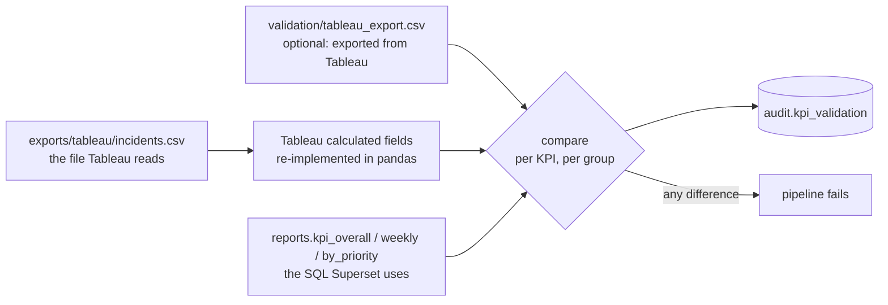

# Data quality and validation

Two questions are answered on every pipeline run:

1. **Is the data fit to report on?** Data quality checks on the source file, staging and marts.
2. **Does the new dashboard show the same numbers as the old one?** KPI parity between the legacy Tableau logic and the new stack.

Results are stored in the `audit` schema and shown on the **Migration QA & Data Health** dashboard in Superset.

## 1. Data quality checks

### File contract (before loading): `pipeline/extract.py`

| Check | Fails when |
|---|---|
| Exact header | A column is renamed, added, removed or reordered |
| Row count | Fewer than 1,000 data rows (truncated download) |
| Field count per line | A line has more or fewer than 36 fields |
| Incident number format | IDs in a 5,000-row sample don't look like `INC0001234` |
| Date format | Timestamps in the sample aren't day-first `d/m/yyyy hh:mm` |

### Table checks: `pipeline/quality.py`

Each check is a SQL query that counts the rows breaking a rule. **error** stops the pipeline; **warn** is recorded and shown.

| Layer | Check | Severity | Result on the real data |
|---|---|---|---|
| staging | Every raw row arrives in staging | error | Pass (0) |
| staging | Incident number never null | error | Pass (0) |
| staging | Incident number format | error | Pass (0) |
| staging | `opened_at` parsed on every event | error | Pass (0) |
| staging | Never resolved before opened | error | Pass (0) |
| staging | Valid ServiceNow state | warn | Warn: 5 rows with state `-100` |
| staging | `(incident, sys_mod_count)` unique | warn | Warn: 5 duplicate versions, resolved by latest update |
| staging | Closed not before resolved | warn | Pass (0) |
| staging | < 15% of incidents without assignment group | warn | Pass (8.8%) |
| marts | One fact row per incident | error | Pass (0) |
| marts | No negative durations | error | Pass (0) |
| marts | Every priority in `dim_priority` | error | Pass (0) |
| marts | Every category in `dim_category` | error | Pass (0) |
| marts | One state interval per event | error | Pass (0) |
| marts | < 2% of incidents outside the analysis window | warn | Pass (1.1%) |
| reports | **Knowledge flag level shift** (> 40 points day over day) | warn | Warn: 1 jump: 11 Mar 2016 |
| reports | **SLA flag level shift** (> 40 points day over day) | warn | Warn: 1 jump: 16 Mar 2016 |

### Known data issues and decisions

| Issue | Evidence | Decision |
|---|---|---|
| Sparse incidents after May 2016 | Sequential incident numbers: ~100% present Mar–May, 274 stragglers over 9 months | Analysis window 29 Feb – 31 May 2016, others flagged |
| Knowledge flag changes meaning on 11 Mar 2016 | Daily share 97.8% on 10 Mar, 1.5% on 11 Mar, stays ~1% | Reported as defined; not used for impact analysis; flagged on dashboards |
| SLA measurement changes on 16 Mar 2016 | Incidents fixed in < 4 h: 35% met SLA before, 99% after, while resolution times didn't change | KPI kept as defined; insights use incidents from 16 Mar; flagged |
| Invalid state `-100` | 5 events in 2 incidents | Kept and flagged, excluded from time-per-state |
| Duplicate event versions | 5 `(incident, sys_mod_count)` pairs | Final snapshot chosen by latest update, then file order |
| Incidents without `resolved_at` | 1,546 in the window | Counted as not resolved; excluded from median |

The level-shift checks are the kind of check that catches "the number changed because someone changed a setting", which no schema test finds.

## 2. KPI parity: legacy Tableau vs new stack

### Why

A migration fails quietly when the new dashboard shows *slightly* different numbers: a filter applied differently, a week starting on another day, a different median, NULLs treated differently. Stakeholders lose trust, and nobody can say which number is right. So parity is tested, not eyeballed.

### How

- **Scope:** 8 KPIs × (overall + 14 weeks + 4 priorities) = **152 comparisons** per run.
- **Tolerance:** counts must match exactly; other KPIs within 0.001 (SQL rounds to 4 decimals). For a real Tableau export, within 0.006, because Tableau exports what it displays, with 2 decimals.
- **Missing groups fail too:** a week present in one tool but not the other counts as a mismatch.
- **Result on the real data:** 152 of 152 match.

### Third check: Superset itself

`superset/verify_kpis.py` asks Superset's query API for the dataset metrics (overall and per priority) and compares them with the SQL views: **40 values, 0 differences**. Together with the parity check this covers the chain *Tableau logic = SQL = what Superset shows*.

### Using a real Tableau export

1. Open `tableau/ServiceDesk_Legacy.twbx` and go to the sheet **KPI Validation**.
2. **Worksheet → Export → Crosstab to Excel**, then save as CSV; or **Download → Crosstab → CSV** in Tableau Public / Server.
3. Save it as `validation/tableau_export.csv` and trigger the DAG.

English and German formats both work (`1,234.56` / `1.234,56`, `2016-02-29` / `29.02.2016` / `2/29/2016`). Column headers must be the KPI captions (`Incidents`, `SLA met (%)`, …), which the workbook already uses.

### Tested failure

A copy of the weekly KPIs in German format with one wrong value (9,999 instead of 1,975 incidents in the week of 14 Mar) was placed as the Tableau export. The run caught exactly that one value, failed `validate_kpis` after its retry, and the watcher task marked the run **failed** in `audit.pipeline_runs`.

## Migration traps this setup catches

| Trap | What happens | How it's avoided here |
|---|---|---|
| **Week start** | Tableau's default week depends on locale (Sunday in the US); PostgreSQL weeks start Monday. Every weekly number shifts. | The extract carries `opened_week_start` (Monday) and both tools group on it. A unit test proves a Sunday-based grouping fails the comparison. |
| **Median definition** | `percentile_disc` returns an actual value, `percentile_cont` / Tableau `MEDIAN` average the middle two | `percentile_cont` everywhere; a unit test checks the even-count case |
| **NULL handling** | `AVG` over a nullable flag skips NULLs and inflates percentages | Flags are made non-null in `fact_incident` (`coalesce(..., false)`) |
| **Different populations** | One tool filters the window, the other doesn't | One view (`reports.incidents_analysis`) feeds both |
| **Locale in exports** | `63,40` read as 6340 | Locale-aware parsing, unit-tested |
